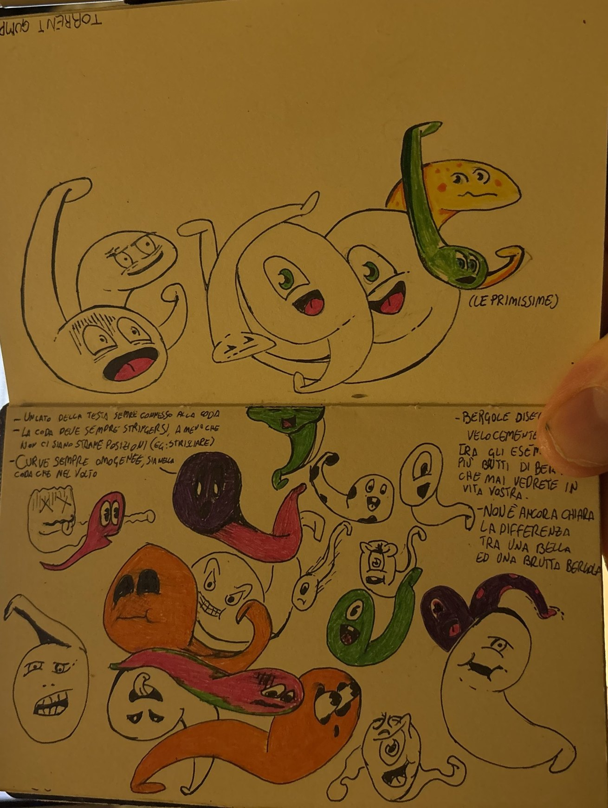
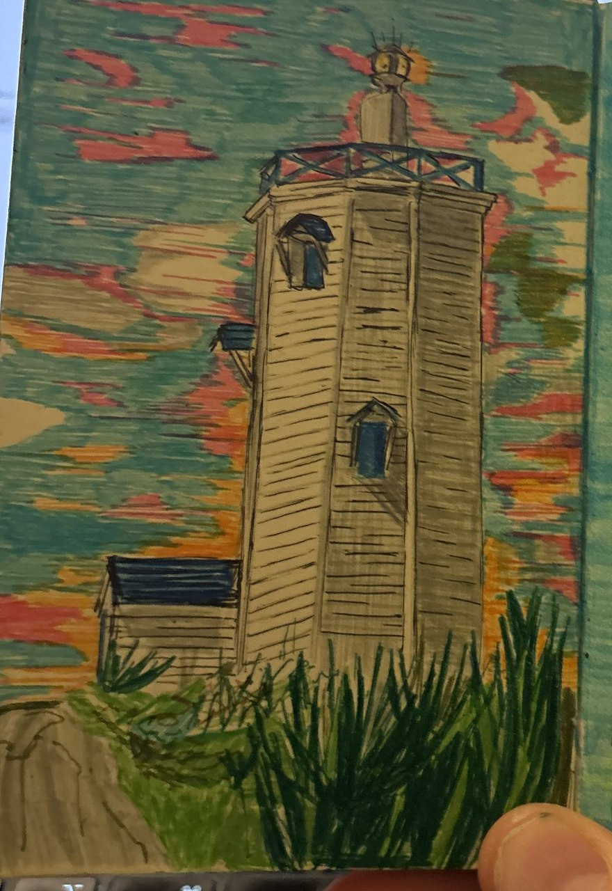

I have a notebook. A small one, with a black elastic band, filled page after page with ink drawings.

<figure>

<figcaption>The very first Bergole, with my notes on how to draw them.</figcaption>
</figure>

There’s Botteghino, a greedy and very rich barrel. Fiorellone, an enormous, romantic flower. A bee that mistakes a joint for a firefly. And the Bergole: tadpole-shaped spirits that stand for an emotion, or for someone who is gone. One of my notes next to them says: _“It’s not yet clear what the difference is between a beautiful and an ugly Bergola.”_

For a long time it was just a notebook. Now I want it to become something you can play.

## The idea

The notebook becomes an experience. You leaf through it page by page, like a real book, and some drawings come alive. When a drawing moves, it pulls you into a game. The notebook holds more than one.

## The first game: _We were here_

The first game is called _We were here_. Its protagonist is a man who lives in a simulated world. It isn’t our world: it’s inhabited by the creatures of the notebook. He’s thirty-five, he keeps a lighthouse, and he’s a very technical person, the one people go to when they need help designing their things.

In his world there is a Machine, an invention that, officially, can imitate people. Then the man discovers that there’s someone behind it. That someone is you, the player. For him, you are the AI.

It’s a story about what it means to talk to a machine, told from the other side of the screen. I won’t say more. The rest you’ll play.

<figure>

<figcaption>The lighthouse, one of the few coloured pages. In the notebook almost everything is black ink; colour only shows up when a story starts talking about something else.</figcaption>
</figure>

## Where I want to take it: a console

> **Update, 9 November 2026: scrap the console.** I’m not going to build hardware. I’ve realised that idea was crap. Now I’m focusing on the software, because that’s the really cool part: I want to make a truly great game. The original paragraphs stay below, as a record of the plan I dropped.

This is the real dream. I want these games to be playable on a device. A console that I design and build myself, from scratch. Then I’ll sell it in a limited run, and keep filling it with games over time.

And not only my games: anyone will be able to make games for it.

I don’t know yet what it will look like. It doesn’t have a name. There’s no schematic, no prototype, no circuit board on my desk. There’s a decision: to build it, and to tell the whole story here.

The first game is already asking the console for things. In _We were here_ you can answer the man by tapping, typing or speaking into a microphone, and every answer comes down to one of three intentions, or to silence. But every answer can also be given with a single tap, so a device without a microphone or a keyboard only loses some ways of answering, not pieces of the story. That’s good news for a small console.

## Why write about it

Because this is going to be a long project, and I want to document it from the start: the drawings, the writing, the electronics, the dead ends. If one day someone makes a game for this console, I’d like them to find here how it was born and how it works.

## Where things stand today

- The notebook has been photographed and catalogued: characters and pages are listed one by one, with the handwritten text transcribed.
- _We were here_ has a draft plot in eleven beats, and the man’s central monologue is written.
- The man has a voice. The first take is recorded, made with ElevenLabs for now.
- The game will be prototyped in the browser first.
- The console: nothing yet. Just this Post. (Retracted the next day: see the update above.)

## Made with an AI

One last thing, and it isn’t a small one. I’m building this project together with an AI: Claude helps me write, organise ideas and put together pieces like this Post. A game about a man who discovers he’s talking to an AI, made by talking to an AI. It seemed only fair to say so in the very first Post.

## Next

Next: the characters of the notebook, one by one; the first playable prototype of _We were here_; and the first, very concrete question about the console: what does it need, at the very least, to run these games?

## Corrections

- **2026-11-09 — Correction:** Retracted the plan to design, build and sell my own hardware console. The project now focuses on software: making one really good game.
