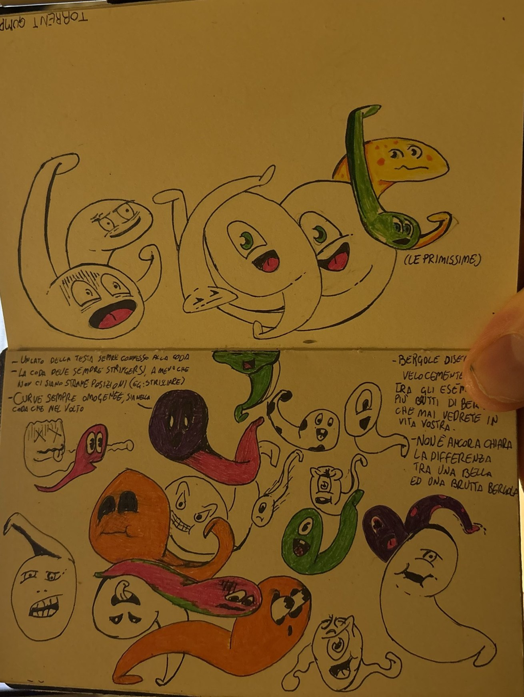
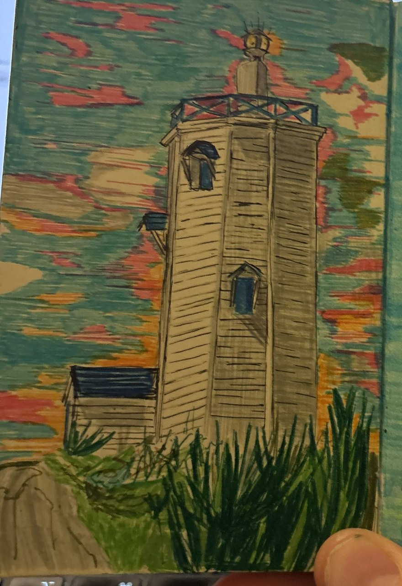

Ho un taccuino. Piccolo, con l’elastico nero, riempito pagina dopo pagina di disegni a inchiostro.

C’è Botteghino, una botte avida e ricchissima. Sulla sua pagina c’è scritta la sua caratteristica principale: è un grandissimo evasore fiscale, e non paga le tasse perché tutti lo credono solo un modo di dire.

<figure>

<figcaption>Botteghino, con la sua pagina di appunti.</figcaption>
</figure>

Poi c’è Fiorellone, un fiore enorme e romantico. Un’ape che scambia uno spinello per una lucciola. E le Bergole: spiriti a forma di girino che rappresentano un’emozione, oppure una persona che non c’è più.

<figure>

<figcaption>Le primissime Bergole, con i miei appunti su come disegnarle.</figcaption>
</figure>

Uno degli appunti accanto a loro dice: _“Non è ancora chiara la differenza tra una bella e una brutta Bergola.”_

Per tanto tempo è stato solo un taccuino. Adesso voglio che diventi qualcosa a cui si può giocare.

## L’idea

Il taccuino diventa un’esperienza. Lo sfogli pagina dopo pagina, come un libro vero, e alcuni disegni si animano. Quando un disegno si muove, ti porta dentro un gioco. Nel taccuino ce n’è più di uno.

## Il primo gioco: _We were here_

Il primo gioco si chiama _We were here_. Il protagonista è un uomo che vive in un mondo simulato. Non è il nostro mondo: è abitato dalle creature del taccuino. Ha trentacinque anni, fa il guardiano di un faro ed è una persona molto tecnica, quello a cui ci si rivolge quando c’è da progettare qualcosa.

Nel suo mondo esiste una Macchina, un’invenzione che, ufficialmente, sa imitare le persone. Poi l’uomo scopre che dietro c’è qualcuno. Quel qualcuno sei tu, il giocatore. Per lui, l’IA sei tu.

È una storia su cosa vuol dire parlare con una macchina, raccontata dall’altra parte dello schermo. Non dico altro. Il resto lo giocherete.

<figure>

<figcaption>Il faro, una delle poche pagine a colori. Nel taccuino quasi tutto è inchiostro nero; il colore arriva solo quando una storia si mette a parlare d’altro.</figcaption>
</figure>

## Dove voglio arrivare: una console

> **Aggiornamento del 9 novembre 2026: niente console.** Non costruirò un hardware. Ho capito che quella era una cagata. Ora mi concentro sul software, perché è la parte davvero figa: voglio proprio fare un gran bel gioco. I paragrafi originali restano qui sotto, come traccia del piano che ho abbandonato.

Questo è il sogno vero. Voglio che questi giochi si possano giocare su un dispositivo. Una console che progetto e costruisco io, da zero. Poi la venderò in tiratura limitata, e continuerò a riempirla di giochi nel tempo.

E non solo dei miei: chiunque potrà farci giochi.

Non so ancora che aspetto avrà. Non ha un nome. Non c’è uno schema elettrico, non c’è un prototipo, non c’è una scheda sulla mia scrivania. C’è una decisione: costruirla, e raccontare qui tutta la storia.

Il primo gioco sta già chiedendo qualcosa alla console. In _We were here_ puoi rispondere all’uomo toccando, scrivendo o parlando al microfono, e ogni risposta si riduce a una di tre intenzioni, oppure al silenzio. Però a ogni domanda si può rispondere anche con un tocco solo, quindi un dispositivo senza microfono né tastiera perde soltanto qualche modo di rispondere, non dei pezzi di storia. Per una console piccola è una buona notizia.

## Perché scriverne

Perché sarà un progetto lungo, e voglio documentarlo dall’inizio: i disegni, la scrittura, l’elettronica, i vicoli ciechi. Se un giorno qualcuno farà un gioco per questa console, mi piacerebbe che trovasse qui come è nata e come funziona.

## A che punto siamo oggi

- Il taccuino è stato fotografato e catalogato: personaggi e pagine sono schedati uno per uno, con il testo scritto a mano trascritto.
- _We were here_ ha una bozza di trama in undici passaggi, e il monologo centrale dell’uomo è scritto.
- L’uomo ha una voce. La prima registrazione è fatta, per ora con ElevenLabs.
- Il gioco si prototipa prima nel browser.
- La console: ancora niente. Solo questo Post. (Ritirata il giorno dopo: vedi l’aggiornamento qui sopra.)

## Fatto con un’IA

Un’ultima cosa, e non è piccola. Sto costruendo questo progetto insieme a un’IA: Claude mi aiuta a scrivere, a mettere in ordine le idee e a montare pezzi come questo Post. Un gioco su un uomo che scopre di parlare con un’IA, fatto parlando con un’IA. Mi sembrava giusto dirlo fin dal primo Post.

## Prossimamente

I personaggi del taccuino, uno per uno; il primo prototipo giocabile di _We were here_; e la prima domanda, molto concreta, sulla console: di cosa ha bisogno, come minimo, per far girare questi giochi?

## Correzioni

- **2026-11-09 — Correzione:** Ritirato il piano di progettare, costruire e vendere una mia console hardware. Il progetto ora si concentra sul software: fare un gioco davvero bello.
